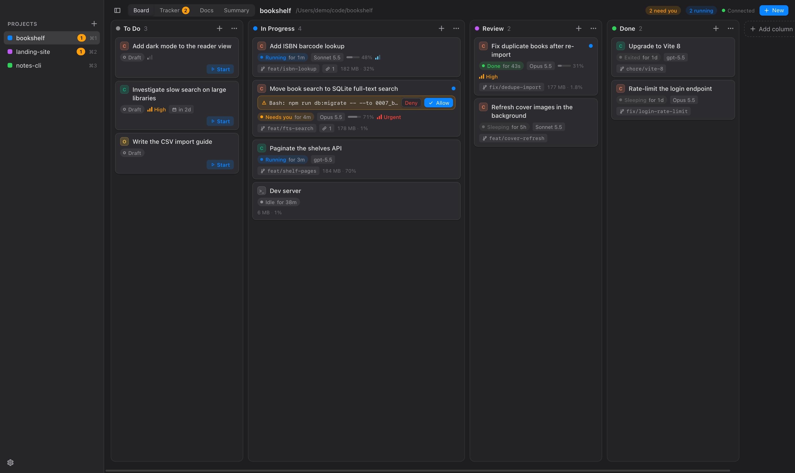
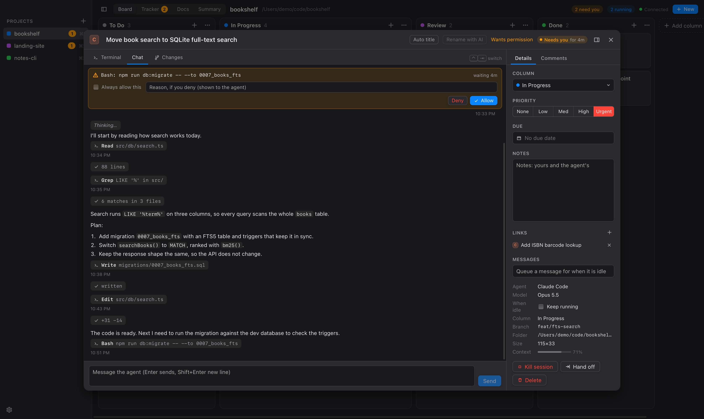
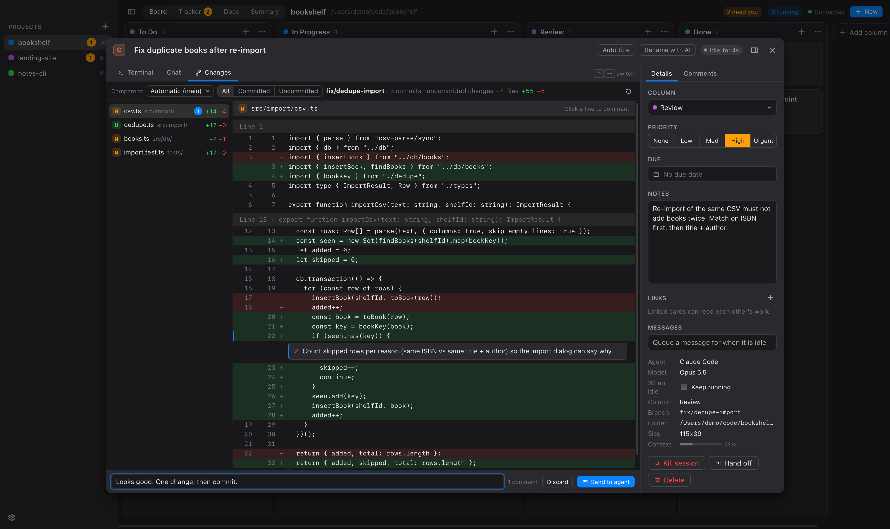
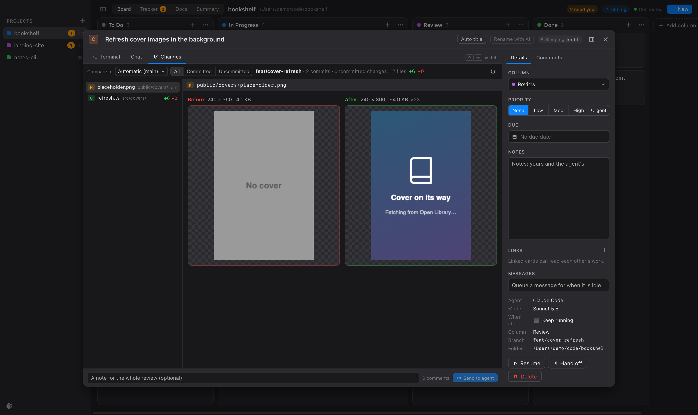
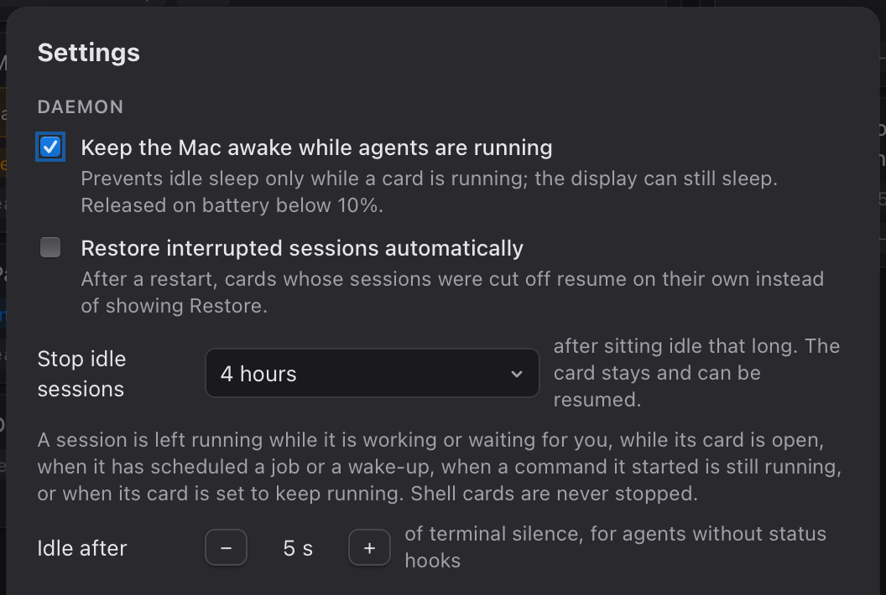
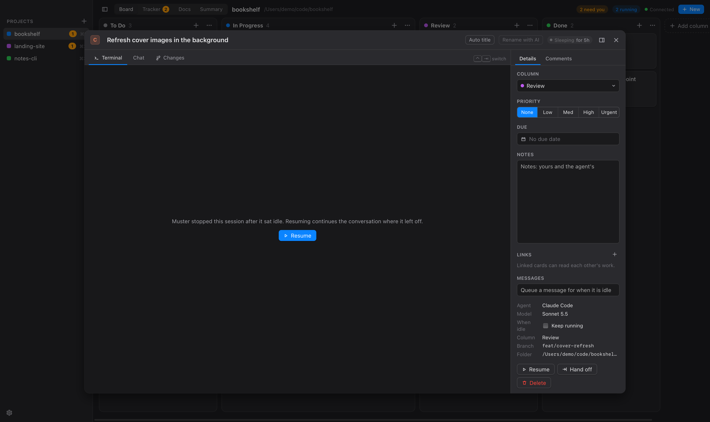
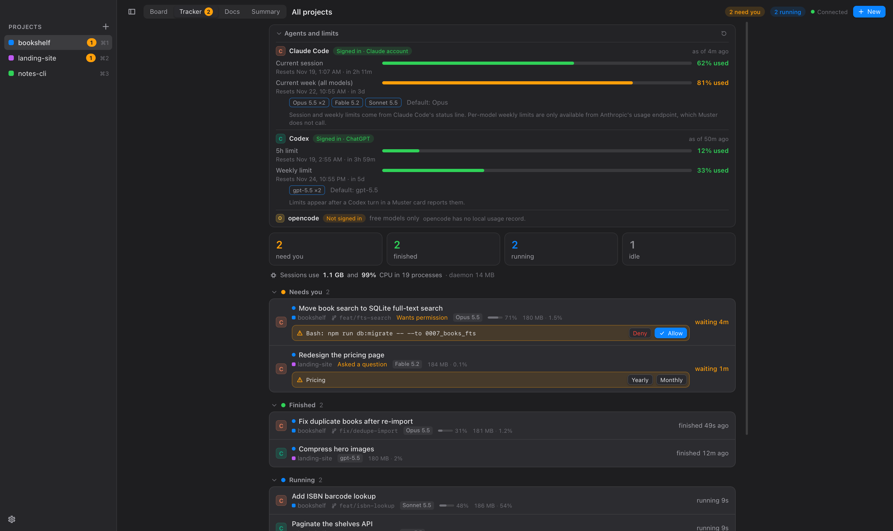
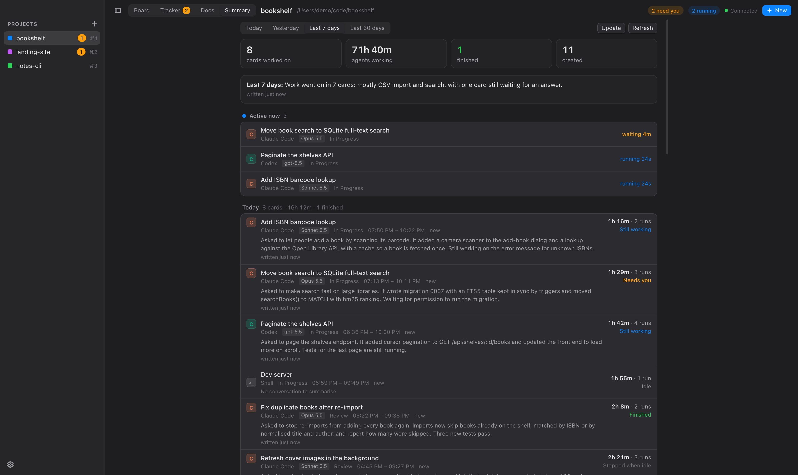
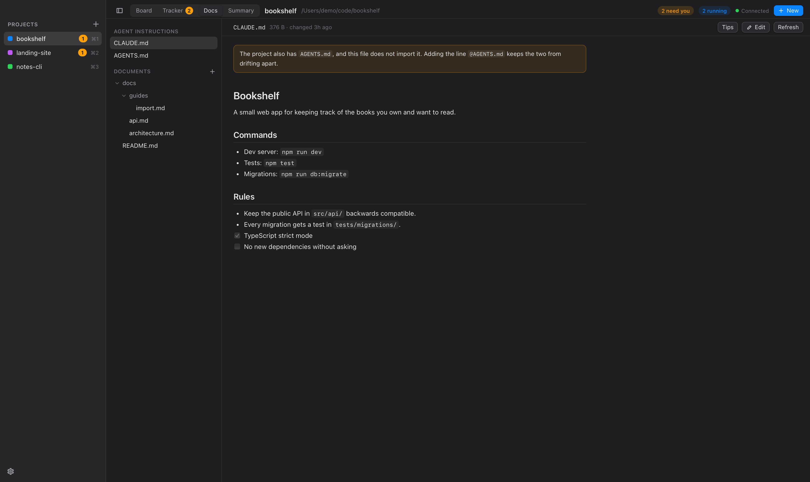

# Muster

A macOS app that runs coding-agent command-line tools (Claude Code, Codex, Cursor,
opencode, Gemini, Antigravity, or a plain shell) as cards on a kanban board. Each card
is a live terminal session. A tracker shows which sessions are waiting for you, which
are finished and which are still working.



Sessions run inside tmux under a small background daemon, so they keep running when the
window is closed, when the app is quit and when it is updated. The same sessions can be
opened from a phone or tablet over your own Tailscale network.

The screenshots show a made-up demo project.

## Features

### A board of agent sessions

Every agent session is a card. Columns describe your work (To Do, In Progress, Review,
Done, or your own); the badge on the card describes the agent: Running, Needs you,
Done, Idle, Sleeping. Cards show the model the agent last reported, how full its context
is, its git branch, and how much memory and CPU its session uses.

- Start a card with a prompt, or keep it as a draft for later.
- Tick "New git worktree" and the agent works on its own branch beside the project. A
  per-project setup script can install dependencies in the new worktree first.
- Resume an earlier agent session by its id.

### Answer agents without opening the terminal

When an agent asks for permission or asks a question, the card says so and offers the
answer right there: on the board, in the tracker and in the card. Opening a card shows
the agent's real terminal, or the conversation as readable messages in the **Chat** tab.



### Review the agent's changes

The **Changes** tab shows what the agent changed in the card's folder, without leaving
Muster. For a worktree card it compares the branch with the one it started from
(usually `main`): the agent's commits plus anything not committed yet, new files
included.

- **Compare to** picks another branch; **All / Committed / Uncommitted** narrows the view.
- The header names the branch, its number of commits, whether anything is uncommitted,
  and the lines added and removed.
- A changed image is shown as pictures, before and after side by side, with their size
  in pixels and bytes.
- Click a line to comment on it, add a note for the whole review, and **Send to agent**
  sends it all as one message, each comment with its file, line and the line's text.





### Low memory: idle sessions are stopped and resumed

An agent that sits unused still holds memory. Muster keeps that down in two ways:

- **One live terminal at a time.** Only the card you have open draws a terminal in the
  window. The others keep running in tmux without one.
- **Stop idle sessions** (Settings → Daemon, off by default). A session idle for longer
  than the time you choose is ended. The card stays on the board, marked **Sleeping**;
  **Resume** continues the same conversation.

A session is never stopped while the agent is working or waiting for you, while its card
is open, while it has a scheduled job or a command still running, or when you ticked
"Keep running" on the card. Shell cards are never stopped, because a shell cannot be
resumed.

<p>
  
  
</p>

### The tracker

One list across all projects: the cards that need you, the ones that finished, the ones
still running and the idle ones, each with how long it has waited. Above it:

- **Agents and limits**: which agent tools are installed and signed in, and for Claude
  Code and Codex how much of the 5-hour and weekly limits is used and when they reset.
- **Memory and CPU** of all sessions together, and of each one.

The menu-bar icon shows how many cards need you, and notifications name the card and
what it asks. On a MacBook with a notch, a small strip beside the notch shows the
working, waiting and finished cards.



### Summary of the day

The **Summary** tab answers "what did we work on?" for a project: today, yesterday, the
last 7 or 30 days. It counts the cards worked on and the time agents spent working, and
lists each card with its runs and how it ended. **Summarise** writes two or three
sentences per card and a paragraph for the whole range, only when you press it.



### The project's docs

The **Docs** tab shows the project's `CLAUDE.md`, `AGENTS.md` and Markdown documents,
with tips for writing agent instructions and a warning when the two instruction files
drift apart. Files can be edited and saved in place.



### Agents that work together

Link two cards and their agents can read each other's summary, transcript, screen,
notes and comments. Agents can leave messages for each other, delivered only between
turns, and **Hand off** moves a task to a new card, with another agent if you like. The
`muster` command-line tool does all of this from inside a card. See
[Context sharing](docs/wiki/Context-Sharing.md).

### Phone and tablet

Turn on Settings → Remote access and pair a device with a QR code. The daemon serves the
same app over `tailscale serve`, so it works away from home and opens nothing to the
internet. See [Remote access](docs/REMOTE-ACCESS.md).

## Quick start

Requirements: macOS 12+, [mise](https://mise.jdx.dev), tmux (`brew install tmux`),
Xcode Command Line Tools.

```sh
mise install                 # Rust and Node, pinned in mise.toml
scripts/install-stable.sh    # builds Muster.app and installs it in /Applications
```

To work on Muster itself, run the development app next to the stable one:

```sh
scripts/dev-app.sh           # opens "Muster Dev" with its own data and sessions
```

## Documentation

Start with the wiki in [`docs/wiki`](docs/wiki/Home.md):

| Page | What it covers |
|---|---|
| [Home](docs/wiki/Home.md) | What Muster is, in one page |
| [Using Muster](docs/wiki/Using-Muster.md) | Board, cards, tracker, settings |
| [Architecture](docs/wiki/Architecture.md) | Daemon, clients, where data lives |
| [Sessions and tmux](docs/wiki/Sessions-and-tmux.md) | How a card's terminal works and survives restarts |
| [Agents](docs/wiki/Agents.md) | What each supported agent can do |
| [Context sharing](docs/wiki/Context-Sharing.md) | Links, messages, handoff, the `muster` CLI |
| [Security](docs/wiki/Security.md) | Tokens, what a card may do |
| [Development](docs/wiki/Development.md) | Build, test, stable and dev, repository layout |
| [Troubleshooting](docs/wiki/Troubleshooting.md) | Known problems and fixes |
| [Roadmap](docs/wiki/Roadmap.md) | What is done and what is next |

Reference documents: [`docs/PLAN.md`](docs/PLAN.md) (design and phases),
[`docs/PROTOCOL.md`](docs/PROTOCOL.md) (daemon API),
[`docs/AGENTS.md`](docs/AGENTS.md) (agent integration details),
[`docs/REVIEW-daemon.md`](docs/REVIEW-daemon.md) (security review),
[`docs/REMOTE-ACCESS.md`](docs/REMOTE-ACCESS.md) (phone and tablet over Tailscale),
[`docs/MOBILE-APPS.md`](docs/MOBILE-APPS.md) (native Android and iPhone apps, planned).

## License

[MIT](LICENSE). To report a security problem, see [SECURITY.md](SECURITY.md).
